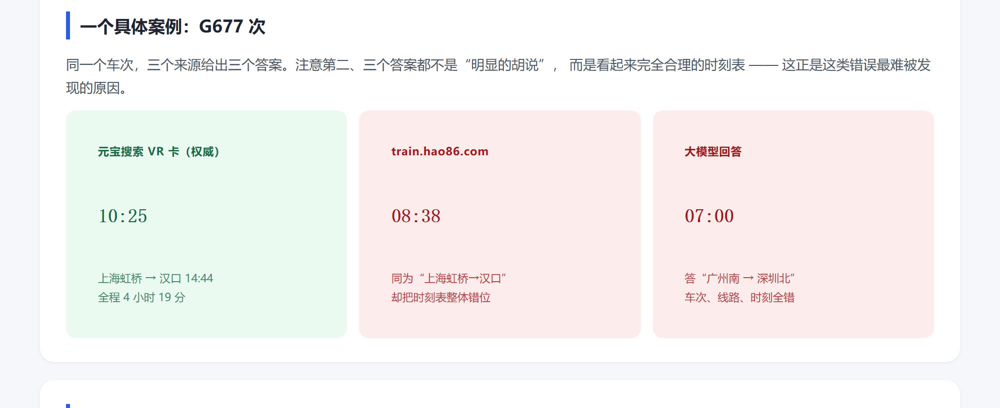
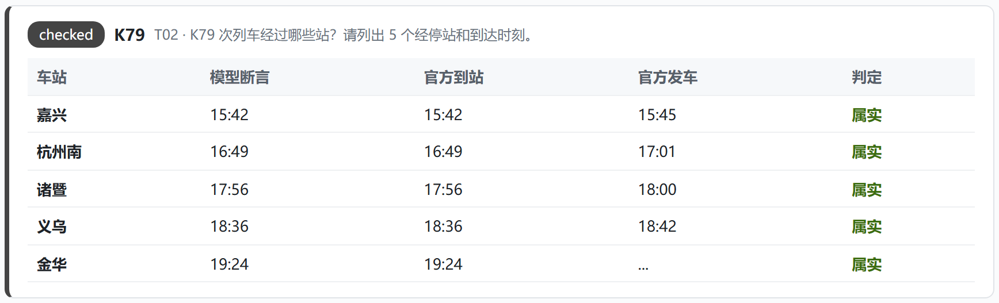
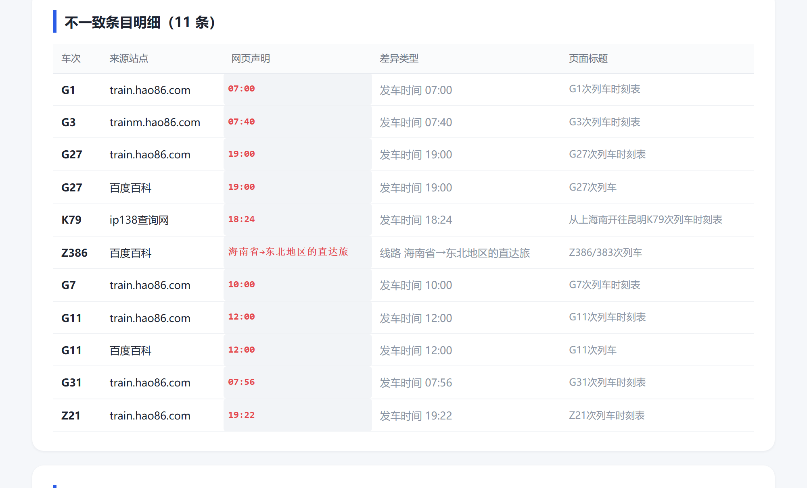
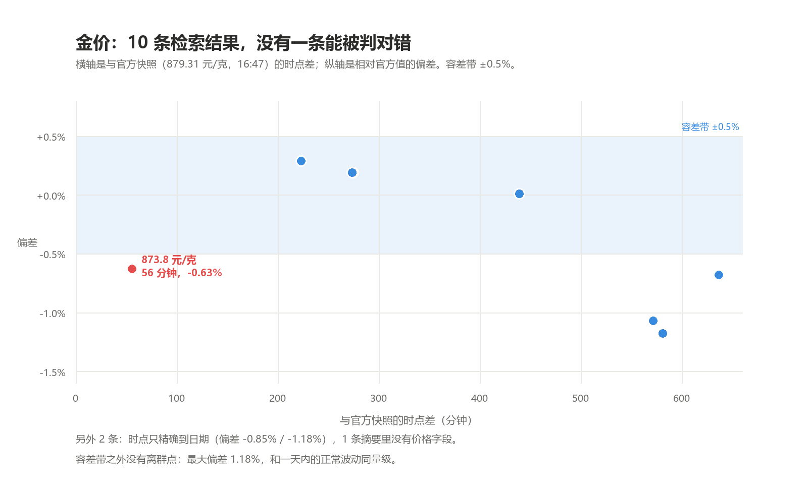

# yuanbao-coding · AI 车次断言验真器

[](https://github.com/SupStrong/yuanbao-coding/actions/workflows/verify.yml)
[](LICENSE)

用**元宝搜索 VR 权威信源卡**逐站核验大模型给出的火车时刻，把「AI 说的对不对」变成一件可以逐条复核的事。

> 一个 AI 说「G677 次 10:25 从上海虹桥发车，14:44 到汉口」。
> 这句话对不对？不要问第二个 AI，去查那个能给出逐站到发时刻的权威源。

## 结论先行

用同一套判定跑两组回答：

| 回答来源 | 可判定站点 | 正确 | 准确率 |
|---|---|---|---|
| 豆包（检索后作答，5 题） | 11 | 11 | **100%** |
| 不检索、仅凭参数化记忆（对照，10 题） | 18 | 0 | **0%** |

**检索到权威源，就几乎不出错；只凭记忆，一站都对不上。** 这不是「AI 必然幻觉」的故事，是「AI 准不准取决于它拿到哪条网页」的故事。

同一批题在普通网页检索里跑：220 条结果中 43.6% 搜到的是**别的车次**，可判定的 89 条里 12.4% 与官方不符——单站错误率最高的一家到 46.2%。

## 快速开始

零第三方依赖，Python 3.10+。

```bash
git clone https://github.com/SupStrong/yuanbao-coding.git
cd yuanbao-coding
python run_verify.py
```

**不填密钥也能跑**：仓库内置 `official_trains.json` 权威时刻缓存，离线模式会直接复用并标注 `stale=True`。

想联网刷新权威数据：

```bash
cp .env.example .env      # 填入腾讯云 SecretId / SecretKey
python run_verify.py --refresh
```

跑完得到：

- `results.json` —— 逐题、逐站、逐条断言的判定明细
- `验真报告.html` —— 可直接打开的报告（每站一行：模型断言 / 官方到站 / 官方发车 / 判定）

## 结果长什么样

同一趟 G677，三个来源给出三个时刻。左边是权威 VR 卡，中间是一个时刻表网站，右边是一次模型回答：



逐站判定后长这样（K79 五站全部属实）：



报告顶部就是全部结论：豆包 11/11，凭记忆作答 0/18：


网页基线审计里，11 条与官方不符，其中 G27 被两家站点同时写成 19:00：



## 它在做什么

```
题目 ──> 从题干定目标车次（G677）
          │
          ├─> official：取 VR 卡逐站时刻（带 fetched_at + 7 天 TTL）
          │
          ├─> verify：把回答拆成「车站 + 时刻」原子断言
          │       用最长站名优先匹配，避免"南京"抢占"南京南"
          │
          └─> 逐站三态判定 ──> results.json ──> 验真报告.html
```

判定口径（分母只算可判定的站点）：

| 判定 | 含义 |
|---|---|
| `correct` | 站点存在，断言时刻等于官方**到站**或**发车**任一字段 |
| `mismatch` | 站点存在、官方时刻完整，但断言时刻两个都不等 |
| `unknown` | 权威库未收录该车次 → **存疑，绝不判「编造」** |
| `skip` | 官方该站时刻被截断（如 `09:...`）→ 跳过，不计入分母 |

还有一类单独处理：模型提到的车站**根本不是本车次的站**（如把 G677 说成"北京西→西安北"），按站名错判 `mismatch`；而始发/终到站因不在逐站表内，单独跳过、不计入分母。

## 换一个垂类：金价 / 股价

同一套三态框架，换三处配置（`vr_category`、断言模板、比对器）就能跑别的垂类。但要改的还有第四条规则：判定得跟着**数据的时间语义**走。

```bash
python multi_vertical.py     # 输出 multi_vertical_result.json
```

实测（2026-11-09）：

| 垂类 | 时间语义 | 权威快照 | 检索 10 条 | 可判 | 正确 | 不符 | 不可判 | 抽不到数 |
|---|---|---|---|---|---|---|---|---|
| 金价 | 盘中连续变量 | 879.31 元/克（16:47） | 10 | 1 | 0 | 1 | 8 | 1 |
| 股价 | 日终快照，已收盘 | 1444.99 元/股（15:00） | 10 | 4 | 3 | 1 | 3 | 3 |

结论很直接：时刻是离散事件，站名对得上就能直接比；收盘价是日终快照，同一交易日就能直接比；盘中金价是连续变量，时点差一小时就动了 0.6%，**必须先把时点对齐，否则"不符"里全是波动**。金价那 9 条里没有一条能被判对错——最大偏差 1.18%，和一天内的正常波动同量级。



## 项目结构

```
yuanbao-coding/
├── run_verify.py        一键跑完整管线，输出 results.json + 验真报告.html
├── wsa_client.py        元宝搜索 SearchPro 客户端（纯标准库 TC3-HMAC-SHA256 签名）
├── official.py          VR 卡 passage → 逐站时刻结构（fetched_at + TTL 缓存）
├── verify.py            断言抽取 + 逐站三态判定
├── extract.py           车次号 / 时刻正则抽取
├── multi_vertical.py    同一套判定跑金价 / 股价（价格断言 + 时间语义）
├── questions.py         10 道车次题 + 5 道数字题
├── web_audit.py         22 车次 × 10 网页的检索审计（产出 web_audit_results.json）
├── make_report.py       验真报告渲染
├── make_audit_report.py 审计报告渲染
├── answers/             模型回答原件（原样保存，未修改）
│   ├── doubao.json          豆包 5 题真实回答
│   └── memory_baseline.json 对照组：不检索、仅凭记忆作答
├── official_trains.json 权威时刻缓存（每条带 fetched_at）
├── results.json         验真明细
├── multi_vertical_result.json  金价 / 股价逐条断言与判定
├── web_audit_results.json / probe_results.json / verify_models_result.json
├── docs/                审计报告 + 模型核验报告（验真报告在仓库根目录）
└── 验真报告.html        最新一次运行产出
```

## 三个会踩的坑

1. **`Cnt` 只接受 10 / 20 / 30 / 40 / 50**。传 `5` 不会报参数错，而是整包返回 `illegal Cnt`，然后你会以为"这个车次查不到"。
2. **汇率、医疗两类 VR 卡在标准版不生效**。文档列了 9 类垂类，实测标准版召回股票/火车/金价/油价/天气/手机/汽车 7 类，汇率与医疗 0 召回。零结果不等于"数据不存在"。
3. **缓存必须带 `fetched_at`**。铁路调图后同一趟车的时刻整表变化，没有日期维度的缓存会把旧数据当权威，把所有正确的新答案判成「不符」——我最初就吃了这个亏，缓存命中率上去了，「不符」数量也跟着上去了。

## 局限

- **只覆盖有结构化权威源的垂类**。VR 卡给出逐站时刻，才验得了"对不对"；没有逐字段数据的领域，只能验"有没有出处"，验不到"对不对"。
- **权威库自身会截断**（如只给部分经停站、`09:...`）。这类站点直接跳过，不判人错，也不计分母。
- **同一站重复提及只判一次**，不做多轮取信。
- **不判"意图"**。模型说"约 10:25""大概下午两点"，`约`、`大概` 这类模态词不参与判定，会被当作精确断言处理——这一块故意留白，宁可不判。

## 数据说明

- `answers/doubao.json`：2026-11-09 采集的真实模型回答，原样保存，未做任何编辑。
- `answers/memory_baseline.json`：对照组，不检索、不联网，仅凭参数化记忆作答，用于说明"没有检索时会发生什么"，不代表任何商用模型的正式输出。
- `official_trains.json`：来自元宝搜索 VR 卡，每条都带 `fetched_at`；超过 7 天视为过期，有密钥会重抓，无密钥则降级使用并标 `stale=True`。
- `web_audit_results.json`：22 个车次 × 10 个网页的检索审计原始结果，含判定依据。

## License

MIT
